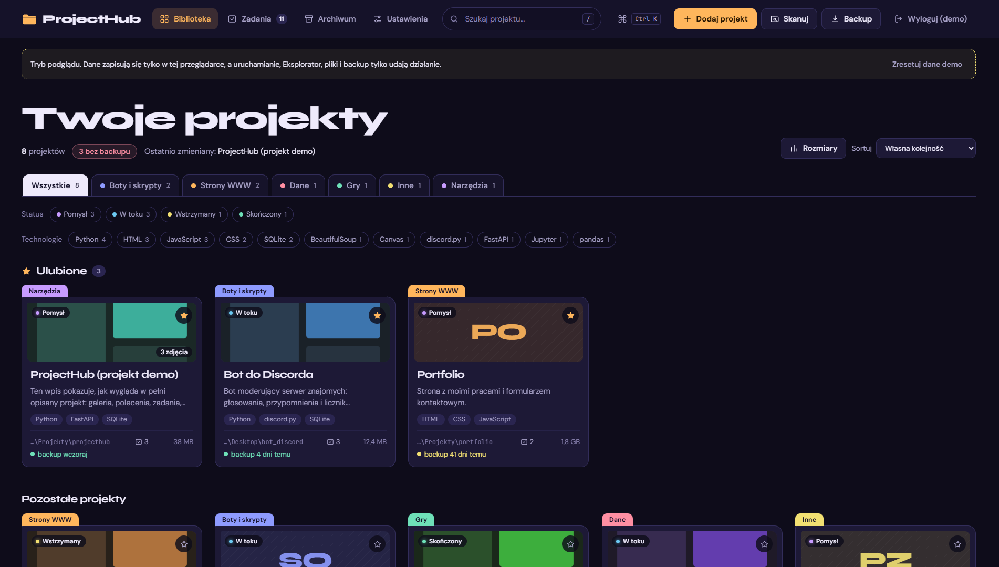

<div align="center">

# ProjectHub

**The local-first workspace manager & execution hub for developers.**

ProjectHub connects your scattered code repositories, local paths, dev commands, and notes into one unified, secure dashboard.

<br>

<p align="center">
  <a href="https://github.com/Kukkenn/projecthub"></a>
  <a href="https://github.com/Kukkenn/projecthub"></a>
  <a href="https://github.com/Kukkenn/projecthub"></a>
  <a href="https://github.com/Kukkenn/projecthub"></a>
</p>

<p align="center">
  <a href="#-project-showcase">
    
  </a>
</p>

</div>

---

> [!NOTE]
> **Local-First & Private:** ProjectHub runs locally on `127.0.0.1`. Your code, database records, and session history remain strictly on your machine and never hit external clouds.

---

##  &nbsp;Why ProjectHub?

Managing multiple active development projects across local directories often leads to terminal chaos, forgotten custom execution commands, scattered Markdown files, and unorganized screenshots.

ProjectHub bridges the gap between raw file explorers and heavy IDE workspace configurations by providing an independent execution, storage, and cataloging harness.

### Comparison: Traditional File Organization vs. ProjectHub

| Feature / Challenge | Traditional Folder Storage | Open Cloud Managers | ProjectHub (Local-First) |
| :--- | :--- | :--- | :--- |
| **Data Privacy** | Local, but unindexed | Cloud-dependent, remote host | **100% Local (SQLite + WAL)** |
| **Execution Control** | Manual terminal navigation | Not supported | **1-Click Custom Commands** |
| **Web Previewing** | Manual local server setup | Shared public links | **Tokenized CSP Sandbox** |
| **Documentation & Tasks** | Random scattered `.txt`/`.md` | Separate third-party apps | **Embedded Workspace Docs & Tasks** |
| **Backup Integrity** | Manual copying | Cloud subscription sync | **Automated 1-Click ZIP Archives** |

---

##  &nbsp;Key Features

* **Dual Storage Architecture:**
  * **Managed Workspace:** Upload project contents directly into ProjectHub's storage with built-in file tree inspection, text editor, and ZIP handlers.
  * **Local Pointer Mode:** Point directly to existing directories anywhere on your local system without moving or altering source files.
* **Command Automation:** Save per-project execution scripts (e.g. `npm run dev`, `python main.py`, `pytest`) and execute them with direct output isolation.
* **Token-Authenticated Web Previews:** Test frontend HTML/CSS/JS builds in an isolated sandbox environment protected with strict Content Security Policy (`CSP`) headers.
* **Directory Tech Scanner:** Scan system directories to automatically recognize project stacks (Python, Node.js, Rust, Go, Docker, C#) and batch-import project structures.
* **Security Hardening:** Built-in defenses against Zip-Slip exploits, path traversal attacks, rate-throttled login attempts (PBKDF2), and CSRF validation.

---

##  &nbsp;Getting Started

> [!WARNING]
> Running in **Hosted Mode** disables direct system path pointers and raw terminal executions for host security. Use **Managed Storage** when hosting remotely.

### Option 1: Standalone Build (.exe)

1. Download the latest `.exe` release package.
2. Launch `start.bat` or run `projecthub.exe`.
3. Open `http://127.0.0.1:8000` in your web browser.

### Option 2: Run From Source

```bash
# Clone repository
git clone [https://github.com/Kukkenn/projecthub.git](https://github.com/Kukkenn/projecthub.git)
cd projecthub

# Install required backend dependencies
pip install -r requirements.txt

# Start local FastAPI server
python -m uvicorn backend.main:app --host 127.0.0.1 --port 8000
```

---

##  &nbsp;Project Structure

```text
projecthub/
├── backend/            # FastAPI Core Server & Business Logic
│   ├── accounts.py     # User creation, guide seeding & credentials
│   ├── config.py       # Global environment & feature switches
│   ├── db.py           # SQLite connection pool, WAL mode & migrations
│   ├── export.py       # ZIP archiving, metadata export & backup builder
│   ├── fsutil.py       # Safe path operations, directory sizing & sandbox rules
│   ├── guide.py        # Default guide project templates & pages
│   ├── main.py         # App entry point, FastAPI routing & security guards
│   ├── manage.py       # Database management & CLI admin routines
│   ├── run.py          # Standalone launcher script
│   ├── security.py     # Throttling, hashing & CSRF token generation
│   └── validate.py     # Input sanitation & schema validation
├── desktop/            # Desktop wrapper and packaging files
├── static/             # Frontend Single Page Application (SPA)
│   ├── css/            # Modular stylesheets (project, style, themes, views)
│   └── js/             # SPA client modules (app, api, md, lib, upload, views...)
├── index.html          # Main workspace dashboard layout
├── login.html          # Authentication portal
├── Dockerfile          # Containerized deployment setup
├── docker-compose.yml  # Docker multi-container orchestration
├── Caddyfile           # Reverse proxy configuration
├── start.bat           # Windows 1-click execution script
├── start.sh            # Linux/macOS 1-click execution script
└── requirements.txt    # Python runtime dependencies
```

---

##  &nbsp;Project Showcase

### Main Dashboard & File Explorer
<p align="center">
  
  <br>
  <em>Main dashboard showing active project workspace, quick filters, and status tags.</em>
</p>

### Module Breakdowns

| Embedded File Manager & Editor | Isolated Web Sandbox Preview |
| :---: | :---: |
|  |  |
| *Integrated directory listing, Markdown viewer, and file editor.* | *Token-authenticated live HTML sandbox with CSP protection.* |

| Task Tracker & Workspace Docs | Backup & Archive Manager |
| :---: | :---: |
|  |  |
| *Embedded task checklists and multi-page documentation.* | *Automated ZIP exports and background system archives.* |

---

##  &nbsp;Star History

<div align="center">

[](https://star-history.com/#Kukkenn/projecthub&Date)

</div>

---

##  &nbsp;License

MIT © [Bartosz Grześkowiak (Kuke)](https://github.com/Kukkenn)
