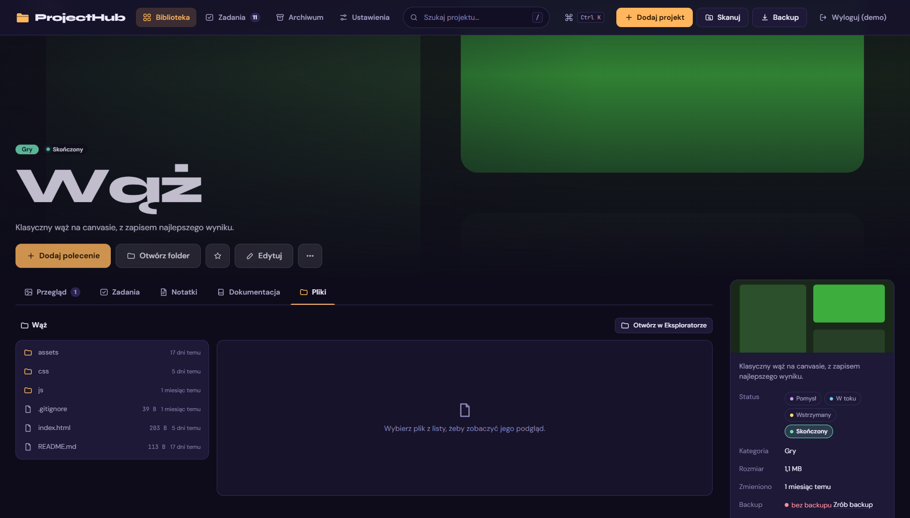
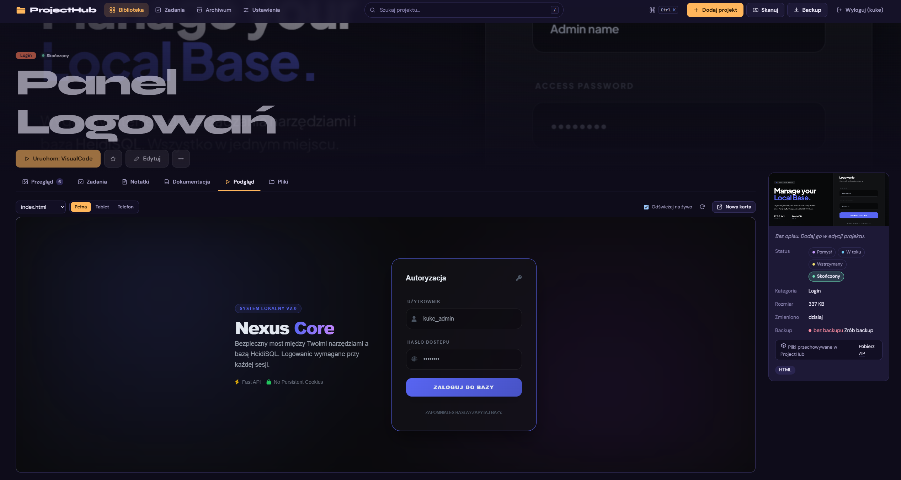
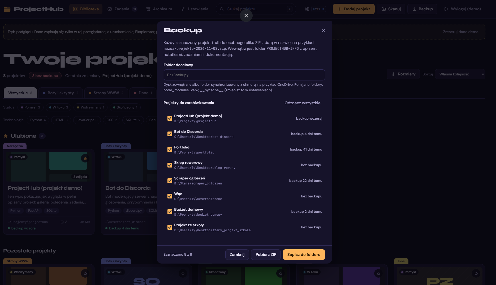

<div align="center">

# ProjectHub

**Lokalne centrum zarządzania projektami i uruchamiania środowisk dla programistów.**

ProjectHub łączy Twoje rozproszone repozytoria, lokalne ścieżki dyskowe, polecenia deweloperskie i notatki w jednym, bezpiecznym panelu.

<br>

<p align="center">
  <a href="[https://github.com/Kukkenn/projecthub](https://github.com/Kukkenn/projecthub)"></a>
  <a href="[https://github.com/Kukkenn/projecthub](https://github.com/Kukkenn/projecthub)"></a>
  <a href="[https://github.com/Kukkenn/projecthub](https://github.com/Kukkenn/projecthub)"></a>
  <a href="[https://github.com/Kukkenn/projecthub](https://github.com/Kukkenn/projecthub)"></a>
</p>

<p align="center">
  <a href="#-prezentacja-projektu">
    
  </a>
</p>

</div>

---

> [!NOTE]
> **Prywatność i tryb lokalny (Local-First):** ProjectHub działa lokalnie pod adresem `127.0.0.1`. Twoje pliki, baza danych i sesje pozostają wyłącznie na Twoim komputerze i nigdy nie trafiają do chmury.

---

##  &nbsp;Dlaczego ProjectHub?

Zarządzanie wieloma projektami programistycznymi w folderach dyskowych często prowadzi do chaosu w terminalu, zapomnianych poleceń startowych, rozproszonych plików Markdown i nieuporządkowanych zrzutów ekranu.

ProjectHub wypełnia lukę między zwykłym Eksploratorem plików a ciężkim środowiskiem IDE, oferując niezależne centrum zarządzania, przechowywania i uruchamiania kodu.

### Porównanie: Zwykłe foldery vs. ProjectHub

| Cecha / Wyzwanie | Tradycyjne foldery na dysku | Zewnętrzne menedżery chmurowe | ProjectHub (Lokalny) |
| :--- | :--- | :--- | :--- |
| **Prywatność danych** | Lokalne, ale nieuporządkowane | Zależne od chmury, zewnętrzny serwer | **100% Lokalne (SQLite + WAL)** |
| **Kontrola uruchamiania** | Ręczna nawigacja w terminalu | Brak obsługi | **Wygodne polecenia 1-Click** |
| **Podgląd stron Web** | Ręczne odpalanie serwerów | Publiczne linki zewnętrzne | **Piaskownica z tokenem i CSP** |
| **Dokumentacja i zadania** | Rozproszone pliki `.txt`/`.md` | Osobne aplikacje trzecich | **Wbudowane notatki i checklisty** |
| **Kopie zapasowe** | Ręczne kopiowanie folderów | Płatna subskrypcja chmury | **Automatyczny backup do ZIP** |

---

##  &nbsp;Główne funkcje

* **Dwa tryby przechowywania:**
  * **Tryb zarządzany (Managed):** Pliki wgrywane bezpośrednio do ProjectHub z wbudowaną przeglądarką drzewa plików, edytorem tekstu i obsługą paczek ZIP.
  * **Tryb lokalny (Local):** Wskazywanie istniejących folderów na dysku bez przenoszenia ani modyfikowania plików źródłowych.
* **Automatyzacja poleceń CLI:** Zapisywanie skryptów startowych (np. `npm run dev`, `python main.py`, `pytest`) dla każdego projektu i uruchamianie ich jednym kliknięciem.
* **Podgląd stron w piaskownicy:** Bezpieczne testowanie aplikacji frontendowych (HTML/CSS/JS) w izolowanym środowisku z nagłówkami Content Security Policy (`CSP`).
* **Skaner technologii:** Automatyczne skanowanie folderów systemowych, rozpoznawanie stosu technologicznego (Python, Node.js, Rust, Go, Docker, C#) i masowy import projektów.
* **Wzmocnione bezpieczeństwo:** Zabezpieczenia przed atakowaniem ścieżek (Zip-Slip, path traversal), limity prób logowania (PBKDF2) i weryfikacja tokenów CSRF.

---

##  &nbsp;Szybki start

> [!WARNING]
> W trybie serwerowym (**Hosted Mode**) bezpośrednie wskazanie ścieżek dyskowych oraz uruchamianie poleceń na hoście są wyłączone ze względów bezpieczeństwa. Korzystaj wtedy z trybu zarządzanego (**Managed Storage**).

### Opcja 1: Wersja samodzielna (.exe)

1. Pobierz najnowszą wersję `.exe`.
2. Uruchom plik `start.bat` lub `projecthub.exe`.
3. Otwórz w przeglądarce adres `[http://127.0.0.1:8000](http://127.0.0.1:8000)`.

### Opcja 2: Uruchomienie ze źródeł

```bash
# Sklonuj repozytorium
git clone https://github.com/Kukkenn/projecthub.git
cd projecthub

# Zainstaluj zależności Pythona
pip install -r requirements.txt

# Uruchom lokalny serwer FastAPI
python -m uvicorn backend.main:app --host 127.0.0.1 --port 8000
```

---

##  &nbsp;Struktura projektu

```text
projecthub/
├── backend/            # Główny serwer FastAPI i logika biznesowa
│   ├── accounts.py     # Tworzenie kont, projekt przewodnika i weryfikacja
│   ├── config.py       # Globalna konfiguracja środowiska i funkcji
│   ├── db.py           # Połączenie SQLite, tryb WAL i migracje bazy
│   ├── export.py       # Archiwizacja ZIP, eksport metadanych i backupy
│   ├── fsutil.py       # Operacje na plikach, obliczanie rozmiaru i piaskownica
│   ├── guide.py        # Szablon przewodnika dla nowych użytkowników
│   ├── main.py         # Punkt wejścia aplikacji, routing FastAPI i CSP
│   ├── manage.py       # Zarządzanie bazą danych i narzędzia admina
│   ├── run.py          # Skrypt uruchomieniowy serwera
│   ├── security.py     # Haszowanie haseł, limity prób i tokeny CSRF
│   └── validate.py     # Walidacja danych wejściowych z formularzy
├── desktop/            # Pliki pakowania aplikacji desktopowej
├── static/             # Interfejs klienta (Single Page Application)
│   ├── css/            # Modułowe style CSS (project, style, themes, views)
│   └── js/             # Moduły JavaScript (app, api, md, lib, upload, views...)
├── index.html          # Główny szablon panelu aplikacji
├── login.html          # Panel logowania i rejestracji
├── Dockerfile          # Konfiguracja kontenera Docker
├── docker-compose.yml  # Orkiestracja kontenerowa Docker Compose
├── Caddyfile           # Konfiguracja serwera proxy Caddy
├── start.bat           # Skrypt szybkiego uruchomienia dla Windows
├── start.sh            # Skrypt szybkiego uruchomienia dla Linux/macOS
└── requirements.txt    # Zależności wymagane przez Python
```

---

##  &nbsp;Prezentacja projektu

### Panel główny i biblioteka projektów
<p align="center">
  
  <br>
  <em>Główny pulpit przedstawiający aktywne projekty, filtry oraz statusy.</em>
</p>

### Moduły aplikacji

| Wbudowany menedżer plików i edytor | Bezpieczny podgląd w piaskownicy |
| :---: | :---: |
|  |  |
| *Drzewo plików, podgląd Markdown oraz edytor kodu.* | *Podgląd stron HTML zabezpieczony tokenem i CSP.* |

| Zadania i dokumentacja projektu | Centrum tworzenia kopii zapasowych |
| :---: | :---: |
|  |  |
| *Checklisty zadań i wielostronicowa dokumentacja.* | *Eksport do paczek ZIP i kopie na dysku zewnętrznym.* |

---

##  &nbsp;Historia gwiazdek

<div align="center">

[](https://star-history.com/#Kukkenn/projecthub&Date)

</div>

---

##  &nbsp;Licencja

MIT © [Bartosz Grześkowiak (Kuke)](https://github.com/Kukkenn)
````

---

### 📌 Instrukcja wgrywania zrzutów ekranu (Gdzie i jakie nazwy):

Aby zdjęcia wyświetlały się poprawnie w serwisie GitHub, utwórz w strukturze swojego repozytorium następujące foldery i dodaj w nich 5 zrzutów ekranu:

1. Ścieżka docelowa: **`docs/screenshots/`**
2. Wymagane nazwy plików w tym folderze:
   * **`library.png`** – Zrzut ekranu głównego widoku biblioteki z kartami projektów.
   * **`files.png`** – Zrzut ekranu otwartej zakładki „Pliki” w menedżerze (drzewo plików/edytor).
   * **`preview.png`** – Zrzut ekranu działającego podglądu strony HTML w piaskownicy.
   * **`tasks.png`** – Zrzut ekranu widoku z listą zadań i stronami dokumentacji.
   * **`backup.png`** – Zrzut ekranu okna dialogowego backupu (wybór projektów i cel ZIP).
